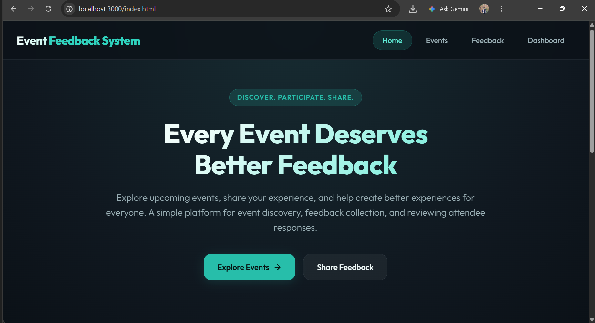
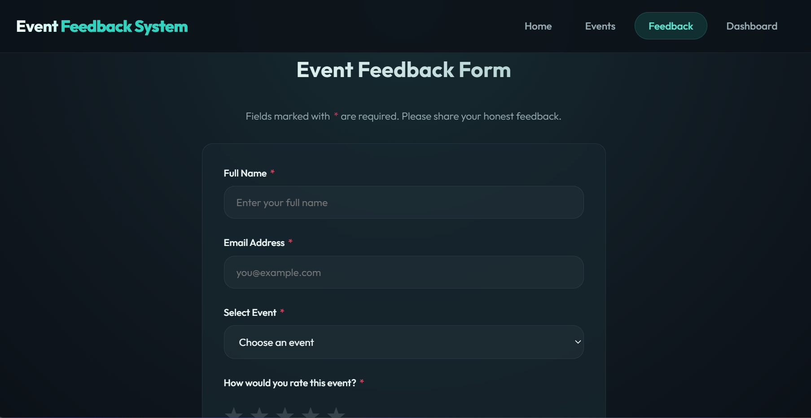
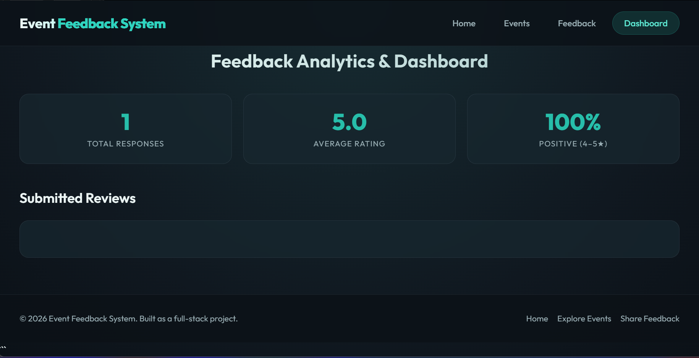

# Event Feedback System

A web-based application designed to collect and manage feedback for events through a simple and user-friendly interface.

The project focuses on making feedback submission easier and helping organizers keep event responses organized in one place.

## Features

- Submit feedback through a simple interface
- Connect the frontend with backend APIs
- Handle and validate user input
- Display feedback data through the application
- Provide a structured way to collect event responses

## Project Preview

### Home Page


### Events Page


### Feedback Page


### Dashboard


## Tech Stack

- **Frontend:** HTML, CSS, JavaScript
- **Backend:** Node.js, Express.js
- **Data Storage:** As configured in the project

## Project Structure

```text
event-feedback-system/
├── public/
│   ├── admin.html
│   ├── app.js
│   ├── events.html
│   ├── feedback.html
│   ├── index.html
│   └── styles.css
├── database.js
├── server.js
├── test.js
├── package.json
├── package-lock.json
├── .gitignore
└── README.md
```

## Getting Started

### 1. Clone the repository

```bash
git clone https://github.com/pranavvv-git/Event-Feedback-System.git
```

### 2. Navigate to the project folder

```bash
cd Event-Feedback-System
```

### 3. Install dependencies

```bash
npm install
```

### 4. Start the server

```bash
node server.js
```

Open the local URL displayed in the terminal to use the application.

## What I Learned

While building this project, I worked on connecting frontend functionality with backend APIs, handling user input, organizing application files, and understanding how different parts of a web application work together.

## Future Improvements

- Add user authentication
- Improve feedback analytics and reporting
- Enhance input validation and error handling
- Improve the overall user experience

## Author

**Pranav Thakur**

GitHub: [pranavvv-git](https://github.com/pranavvv-git)